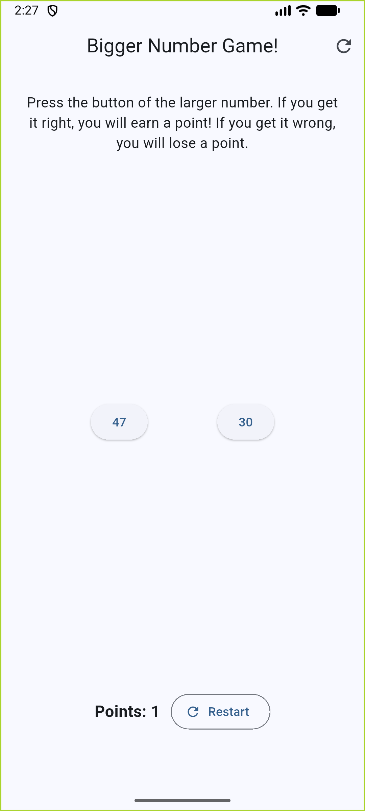
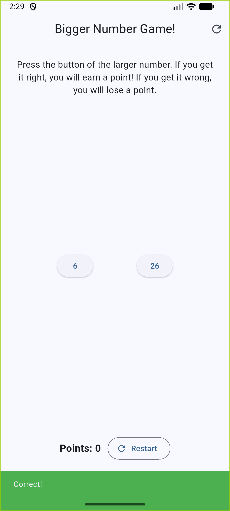
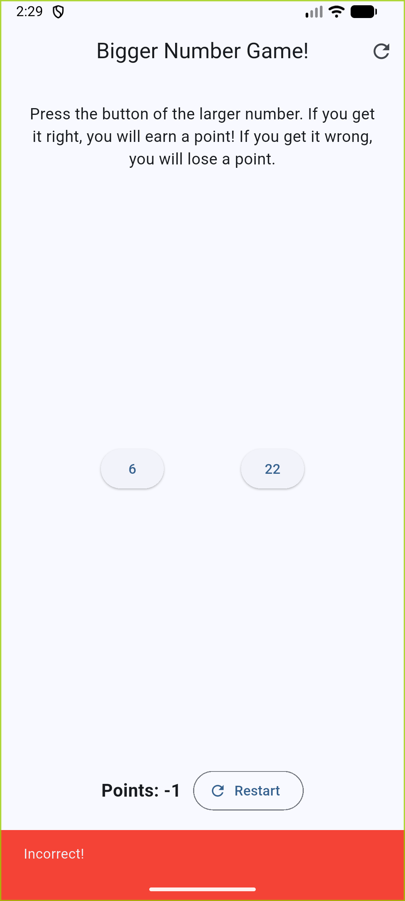

<div align="center">

# CSE489: Android App Development
### Homework 1 – Bigger Number Game

**Student Name:** Monowar Husain  
**Institution:** BRAC University (BRACU)

---

<p align="center">
  
  
  
  
  
</p>

</div>

---

## 📱 App Preview

<table align="center">
  <tr>
    <td align="center">
      <b>Default State</b><br/><br/>
      
    </td>
    <td align="center">
      <b>Correct Guess (+1)</b><br/><br/>
      
    </td>
    <td align="center">
      <b>Incorrect Guess (-1)</b><br/><br/>
      
    </td>
  </tr>
</table>

---

## 🎮 Project Description & Game Rules

**Bigger Number Game** is an interactive mobile application built for **CSE489: Android App Development** at **BRAC University**. The game presents players with two randomly generated numbers and tests their rapid decision-making skills.

### Key Rules & Features:
* **Objective:** Two distinct buttons present randomly generated non-identical integers ranging from 1 to 100 (`1–100`). The player must tap the button displaying the larger number.
* **Scoring Logic:**
  * **+1 Point:** Awarded when the player selects the larger number.
  * **-1 Point:** Subtracted when the player selects the smaller number.
* **Immediate Visual Feedback:**
  * Colored `SnackBar` notifications provide instant feedback without queue delays.
  * **Green SnackBar:** Displays `"Correct!"` when the player picks correctly.
  * **Red SnackBar:** Displays `"Incorrect!"` when the player picks incorrectly.
* **Game Reset:**
  * A **Restart** button (available via the top AppBar icon button or the bottom control button) resets the score tally back to `0`, generates fresh random numbers, and triggers a brief informational `"Game reset"` SnackBar.

---

## 🛠️ Technical Stack

* **Framework:** [Flutter](https://flutter.dev/) (Material 3 UI Toolkit)
* **Language:** [Dart](https://dart.dev/)
* **IDE:** [Android Studio](https://developer.android.com/studio)
* **Testing:** `flutter_test` (Unit and Widget testing)

---

## 🚀 Getting Started

Follow these steps to set up and run the application locally on your machine or emulator:

### Prerequisites
* Flutter SDK (3.x or higher) installed and configured.
* Android Studio or VS Code with Flutter and Dart extensions.
* An active Android Emulator or physical device connected.

### Installation & Execution

1. **Clone the Repository:**
   ```bash
   git clone https://github.com/monowarhusain/bigger_number_game.git
   cd bigger_number_game
   ```

2. **Fetch Dependencies:**
   ```bash
   flutter pub get
   ```

3. **Run the Application:**
   ```bash
   flutter run
   ```

4. **Run Unit & Widget Tests:**
   ```bash
   flutter test
   ```

---

<div align="center">
  <sub>Developed for CSE489: Android App Development at BRAC University</sub>
</div>
